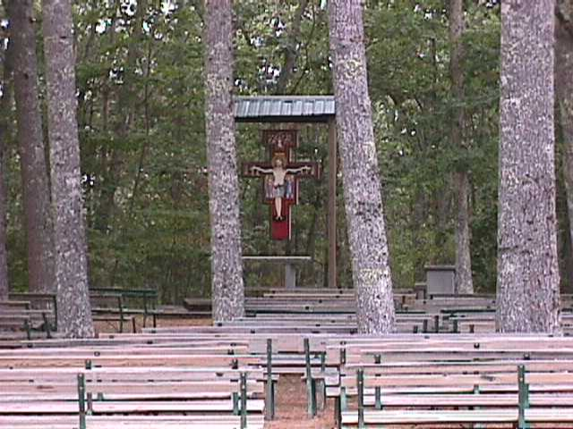

> *My days have passed away, my thoughts are dissipated, tormenting my heart.*  
> **Job 17:11**

I will stop wishing for things that can never happen.

I will never want what I can't have. 

I will be your bittersweet memory, and I will live my life so far from you we may as well be strangers. 
